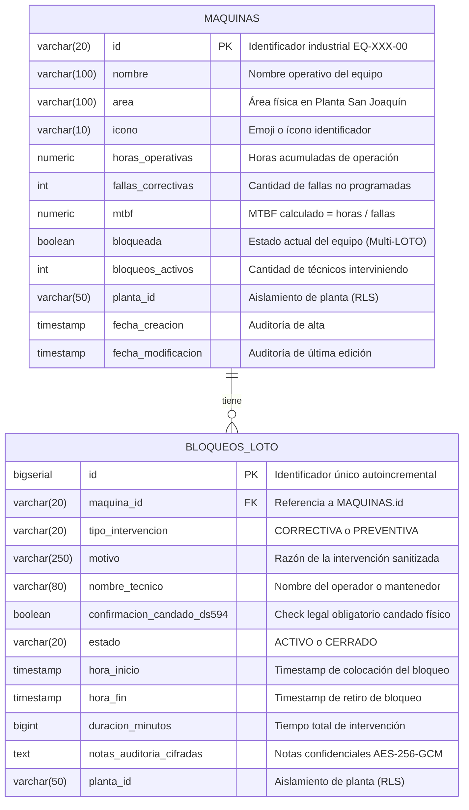

# Modelo de Datos Relacional - SILBOM (Planta San Joaquín)

Este documento describe la estructura de la base de datos relacional para el **Sistema Inteligente de Lectura y Bloqueo Operativo de Maquinarias (SILBOM)**, diseñado para la auditoría de procedimientos LOTO (Lockout / Tagout) bajo normativa chilena (Decreto Supremo 594 y DS 44).

---

## 1. Diagrama Entidad-Relación (Mermaid)

---

## 2. Descripción de Entidades y Restricciones de Ciberseguridad

### Entidad: `MAQUINAS`
* **Propósito:** Catálogo maestro de equipos intervenibles.
* **Clave Primaria (`PK`):** `id` con restricción de expresión regular `CHECK (id ~ '^EQ-[A-Z]{2,4}-[0-9]{2}$')` (Control 14: Validación estricta en base de datos).
* **Multi-LOTO:** Los campos `bloqueada` y `bloqueos_activos` se manipulan conjuntamente de manera atómica (`@Transactional`). La máquina permanece en `bloqueada = true` mientras `bloqueos_activos > 0`.
* **Cálculo MTBF:** Se mantiene sincronizado mediante la regla: si `fallas_correctivas == 0`, `mtbf = horas_operativas`; en caso contrario, `mtbf = horas_operativas / fallas_correctivas` redondeado a 1 decimal.

### Entidad: `BLOQUEOS_LOTO`
* **Propósito:** Registro inmutable de eventos de desenergización y mantención.
* **Clave Foránea (`FK`):** `maquina_id` referencia a `maquinas(id)` con `ON DELETE RESTRICT` (Control de Integridad Referencial: una máquina no puede eliminarse mientras tenga registros asociados o bloqueos activos).
* **Cumplimiento DS 594:** Restricción `CHECK (confirmacion_candado_ds594 = TRUE)`. Ningún registro puede crearse si el operario no declara explícitamente haber puesto su candado mecánico físico.
* **Control 5 (Cifrado en reposo):** El campo `notas_auditoria_cifradas` almacena texto cifrado con el algoritmo estándar simétrico `AES-256-GCM`.
* **Control 4 (Row-Level Security):** Ambas tablas poseen activado `ROW LEVEL SECURITY` y filtran por `planta_id = 'PLANTA-SAN-JOAQUIN'`.
